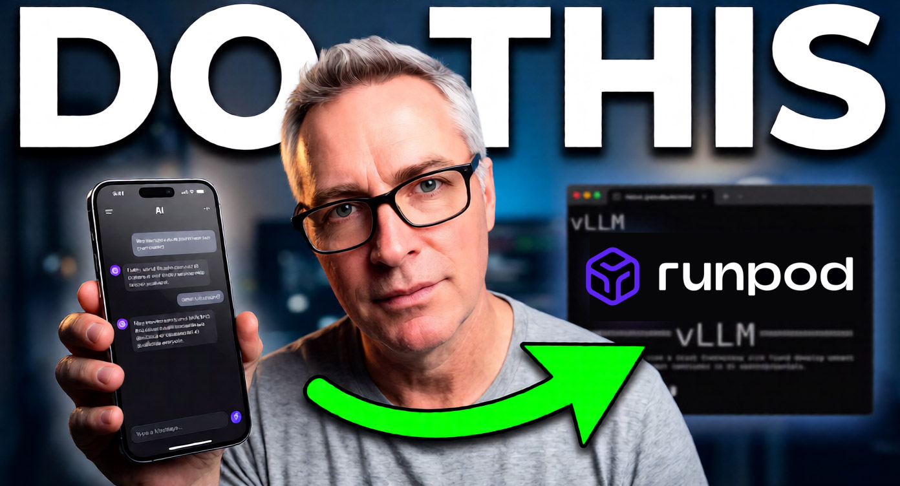
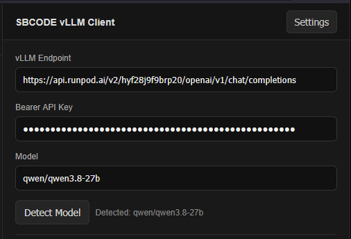

# SBCODE vLLM Client
 
## How to Use
 
Via the website directly : [https://vllm-client.sbcode.net](https://vllm-client.sbcode.net)
 
or,
 
Git clone and run locally,
 
1. Navigate to a folder on your computer where you'd like to download the SBCODE vLLM client.
 
2. Open a command/terminal prompt and execute,
 
    ```bash
    git clone https://github.com/Sean-Bradley/vLLM-Client.git
    ```
 
3. Then go in to the new folder.
 
    ```bash
    cd vLLM-Client
    ```
 
d. Serve the folder using a local static HTTP server and open `index.html` through localhost. Browsers restrict ONNX WebAssembly loading from `file://` URLs; no build step is required.
 
## Video Tutorial
 
[](https://youtu.be/NtcheEus-Fc)
[https://youtu.be/NtcheEus-Fc](https://youtu.be/NtcheEus-Fc)
 
## Configure Settings
 
1. Register at [Runpod](https://get.runpod.io/q0btky2wuu29) _(New users earn a small bonus credit ($5 typical, up to $500 possible) after depositing $10.)_
 
2. Go to **Serverless** tab and choose **vLLM** by **runpod-workers**.
 
3. Press **Deploy v#.##.#**
 
4. Enter a huggingface model.
 
    Some examples
    - Qwen/Qwen2.5-3B-Instruct
    - Qwen/Qwen2.5-7B-Instruct
    - Qwen/Qwen2.5-Coder-32B-Instruct
    - Qwen/Qwen3.8-27B
    - OBLITERATUS/Qwen3.8-27B-OBLITERATED
 
5. Use **Endpoint** deployment type, accept the default **GPU Configuration** and press **Create Endpoint** (Usage is billed per millisecond, but only when workers are in `running` state)
 
6. After it is created, we want to get the vLLM Endpoint URL, but we will use the **OpenAI-compatible** API base URL `/openai/v1` instead.
    1. Open up the **Requests** tab for your serverless vLLM endpoint and copy the `run` url.
 
       E.g.,
 
       `https://api.runpod.ai/v2/YOUR_ENDPOINT_ID/run`
 
    2. remove the `/run` or `/runsync` suffix and replace it with `/openai/v1`
 
       E.g.,
 
       `https://api.runpod.ai/v2/YOUR_ENDPOINT_ID/openai/v1`
 
    3. Paste the new URL into the SBCODE vLLM Client `Settings/OpenAI-compatible API base URL` text field. The client adds `/chat/completions` for chat and `/models` for model discovery.
 
   For other OpenAI-compatible servers, enter a base URL ending in `/v1` (for example, LM Studio commonly uses `http://localhost:1234/v1`). The API key can be left blank unless the server requires one. Browser CORS and HTTPS-to-HTTP mixed-content restrictions still apply; this client cannot bypass them.

 7. Go to the **Overview** tab and generate a new API key.
 
    E.g.,
 
    `rpa_ABCDEFGHIJKLMNOPQRSTUVWXYZ12345678901234567890`
 
    Paste your API key into the SBCODE vLLM Client `Settings/Bearer API Key` text field.
 
 8. Example Settings
 
    
 
    > Note: These settings, including an optional system prompt for each saved configuration, are stored in your browser's local storage for the next time you open this webpage. The system prompt is sent to your configured endpoint with each chat. These settings will not be saved on the https://vllm-client.sbcode.net servers. See the privacy statement when you first open the SBCODE vLLM Client webpage.
 
9. Now you can start chatting.
 
    An example prompt can be, `write a short story about a robot`.
 
    Expect to wait ~5 minutes for a response, depending on the size of the AI model you selected.
 
    > Note: The first time you chat with your Runpod vLLM endpoint, it detects the available model names and saves the configuration in `Settings/Saved Configurations`. If the endpoint returns multiple models, choose one from that configuration's dropdown; the first returned model is selected by default.

    Each assistant response also shows the model used beneath the `ASSISTANT` label. This model name is saved with the conversation and shown when you revisit it.

## Document Attachments

Use the **+** button beside the chat input to select multiple PDF, DOCX, TXT, or CSV files (up to 5 files, 10 MB each). Text is extracted, split into overlapping passages, and indexed in your browser. Ask a question after each attachment shows **Ready for search**; the client embeds the question locally and sends only the five highest-ranked passages to your configured model.

The first attachment triggers a download of the `Xenova/all-MiniLM-L6-v2` embedding model from Hugging Face. The model is cached by the browser; ONNX WebAssembly runtime files are served locally from `libs/`. Document text and embeddings stay in browser memory. Only retrieved passages are saved with their user messages in conversation history and sent to the configured endpoint. Source files and their full extracted text are not saved. After reloading, reattach files to retrieve new passages; saved passages remain available for retries and follow-up history.
 
## Improving Runpod Serverless response times.
 
When we setup this serverless endpoint, the default worker timeout (before it goes back to idle) is 5 seconds. If we don't write our next prompt within that 5 second countdown, our worker will go back into `idle` state and it will take ~5 minutes to wake it up again while it reloads the model into the GPU.
 
We can speed this process up several ways.
 
### Option 1
 
We could increase the `Idle timeout` option to maybe 300 seconds. This is 5 minutes. So, writing another prompt with that 5 minute window means that your worker will answer your chat request almost instantly.
 
Note that while your worker(s) is in the `running` state, you are paying for it.
 
This option is a good compromise when you are only planning to use your serverless endpoint for a few times in a row, maybe several occasions a day. When the endpoint goes back into its `idle` state, it won't cost you any money.
 
### Option 2
 
This option is more expensive, since you will keep your worker(s) in the running state permanently.
 
Set Active Workers from `0` to `1`. If you find your endpoint is under heavier load, then you can increase the `Active Workers` value even higher. Be aware that this will cost even more since you are now permanently using even more GPU resources to store your model.
 
You also have the option to increase the `Max workers` and `GPU count`, but expect the costs to be higher when all workers and GPUs are being utilized.
